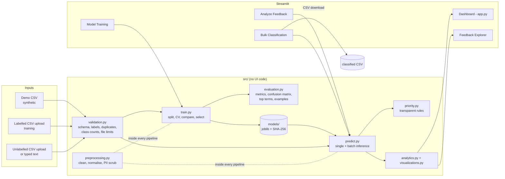

# Smart Feedback Classification System Using Natural Language Processing

A lightweight, fully local machine-learning application that reads written feedback, classifies its **sentiment** (Positive / Neutral / Negative) and **topic** (Academics, Faculty, Infrastructure, Laboratory, Administration, Library, Canteen, Internet and Wi-Fi, Transport, Other), flags items that may need **urgent human attention**, and shows the results in an interactive Streamlit dashboard.

No GPU, paid API or external AI service is used: TF-IDF features + classical scikit-learn classifiers, running on an ordinary laptop.

> **Honest status.** The system is a working end-to-end course project. It is trained and evaluated on a *small synthetic demonstration dataset* that ships with the repo, so the numbers below show that the pipeline works - they are **not** evidence of real-world accuracy. See [Known limitations](#18-known-limitations).

**Contents:** [1 Title](#smart-feedback-classification-system-using-natural-language-processing) · [2 Abstract](#2-abstract) · [3 Problem](#3-problem-statement) · [4 Objectives](#4-objectives) · [5 Existing vs proposed](#5-existing-system-and-proposed-system) · [6 Architecture](#6-system-architecture) · [7 Functional req.](#7-functional-requirements) · [8 Non-functional req.](#8-non-functional-requirements) · [9 Stack](#9-technology-stack) · [10 Dataset](#10-dataset-format-and-limitations) · [11 NLP pipeline](#11-nlp-pipeline) · [12 Algorithms](#12-machine-learning-algorithms) · [13 Install](#13-installation) · [14 Usage](#14-usage) · [15 Methodology](#15-training-and-evaluation-methodology) · [16 Results](#16-actual-evaluation-results) · [17 Screenshots](#17-screenshots) · [18 Limitations](#18-known-limitations) · [19 Future work](#19-future-enhancements) · [20 Conclusion](#20-conclusion)

---

## 2. Abstract

Organisations, colleges and service providers receive far more written feedback than anyone can read. This project builds an NLP system that turns free-text feedback into structured, prioritised information. Text is normalised and converted to TF-IDF vectors of word unigrams and bigrams; two supervised classifiers (one for sentiment, one for topic) are chosen from Logistic Regression, Multinomial Naive Bayes and Linear SVM using cross-validated macro-F1; and a transparent rule-based indicator estimates High / Medium / Low priority. A Streamlit application offers single-text analysis, CSV batch classification with download, model training and evaluation, a dashboard and a feedback explorer. Privacy and reliability are treated as first-class requirements: no personal data is needed, text is not logged, uploads are validated, models are integrity-checked before loading, and every screen states that outputs are predictions that need human judgement.

## 3. Problem statement

Manually reading and organising feedback is slow and makes recurring problems hard to see. The system must help administrators understand:

* whether feedback is positive, neutral or negative;
* which topic / department it concerns;
* whether it may need urgent attention;
* which problems recur;
* how feedback changes over time (only when real timestamps exist).

It **prioritises** feedback for people. It must not make consequential decisions about students, employees or customers automatically.

## 4. Objectives

1. Build a reusable, leak-free NLP pipeline (validation -> normalisation -> TF-IDF -> classifier) that behaves identically in training and prediction.
2. Train and compare several classical models and select one with a defensible metric (macro-F1).
3. Report honest evaluation: accuracy, macro precision / recall / F1, confusion matrices, errors.
4. Provide a usable dashboard for single, batch and exploratory analysis.
5. Validate every input, never silently drop records, and protect privacy.
6. Stay small enough to understand and present in a college viva.

## 5. Existing system and proposed system

| | Existing (manual) | Proposed |
|---|---|---|
| Reading | Staff read every comment | Model pre-classifies; staff read what matters |
| Consistency | Varies by reader and mood | Same input -> same output (fixed seed, deterministic model) |
| Pattern finding | Spreadsheet counting by hand | Dashboard counts, topic and sentiment charts, term frequencies |
| Urgent items | Easily buried | Rule-based priority flags with visible reasons (human verifies) |
| Speed | Days | Seconds for thousands of rows |
| Weakness | Slow, subjective | Learns only from its (small) training data; can be wrong; needs review |

## 6. System architecture



Separation of concerns: `src/` contains no Streamlit imports (except `src/ui.py`, the shared UI helpers), so all logic is unit-testable; pages only call `src/`.

## 7. Functional requirements

| ID | Requirement | Where |
|---|---|---|
| F1 | Classify sentiment into exactly Positive / Neutral / Negative using a *trained* model | `train.py`, `predict.py` |
| F2 | Classify topic into 10 configurable categories with a separate trained model | `config.CATEGORIES` |
| F3 | Estimate High / Medium / Low priority with transparent rules and shown reasons | `priority.py` |
| F4 | Analyse a single typed feedback; handle empty, very long and odd characters | Analyze page |
| F5 | Batch-classify a CSV, preserve original columns/order, append `predicted_*` columns, download | Bulk page |
| F6 | Validate uploaded labelled data; train only after validation succeeds | `validation.py`, Training page |
| F7 | Compare algorithms, show accuracy / precision / recall / macro-F1 / confusion matrices | Training page |
| F8 | Save / reload models; detect missing or corrupted model files | `predict.py` |
| F9 | Dashboard with KPIs, distributions, filters, time trend (only if dates exist) | `app.py` |
| F10 | Searchable explorer with common terms (stop words removed, negations kept) | Explorer page |

## 8. Non-functional requirements

* **Runs locally** on an ordinary laptop; training the demo models takes a few seconds.
* **Reproducible:** fixed seed (42), stratified split, versions recorded in model metadata.
* **Privacy:** no personal data required; no feedback text in logs or metadata; contact details scrubbed before modelling and masked on screen; uploads processed in memory.
* **Security:** upload extension/size/row limits, no loading of user-supplied model files, checksum-verified model loading, spreadsheet-formula neutralisation on export, optional server-side admin passcode for training.
* **Robustness:** bad input never crashes a page; every failure produces a readable message.
* **Maintainability:** modular code, central `config.py`, 102 automated tests.
* **Accessibility:** sentiment colours always accompanied by text labels.

## 9. Technology stack

| Purpose | Tool |
|---|---|
| Language | Python 3.11+ (developed and tested on 3.12.7) |
| UI | Streamlit |
| NLP features | scikit-learn `TfidfVectorizer` (word 1-2-grams), own normaliser |
| Models | scikit-learn: Multinomial Naive Bayes, Logistic Regression, Linear SVM |
| Data | pandas, NumPy |
| Charts | Plotly (Matplotlib is available but not required) |
| Persistence | joblib + JSON metadata |
| Tests | pytest (+ Streamlit `AppTest` for headless UI tests) |

Tested with: scikit-learn 1.9.1, pandas 3.0.6, Streamlit 1.65.0, Plotly 7.1.0.

## 10. Dataset format and limitations

### Built-in demonstration data - `data/demo_feedback.csv`

* 300 rows = 10 categories x 3 sentiments x 10 sentences, perfectly balanced.
* Columns: `feedback_id, feedback_text, sentiment, category, created_at`.
* **Every row is synthetic**: hand-written for demonstration (`scripts/build_demo_dataset.py`), IDs start with `DEMO-`, dates are pseudo-random inside Jan-Apr 2026. It is **not** genuine student or customer feedback and must never be presented as such.
* It is only suitable for demos and smoke tests. Sentences are short, templated in style and far cleaner than real feedback, so scores measured on it are optimistic about real use *and* too few to be statistically stable (the 75-row test set means one prediction moves accuracy by 1.3 points).

### Your own labelled training CSV

Required columns: `feedback_text`, `sentiment`, `category`. Optional: `feedback_id`, `created_at`.

* `sentiment` in {Positive, Neutral, Negative}; `category` in the 10 labels (case/spacing-insensitive; "Internet & Wi-Fi" is accepted).
* Checks: missing columns, invalid labels, empty text, conflicting duplicates (error), exact duplicates (removed **and reported**), at least 30 rows and 5 examples per sentiment and per used category. Errors list the CSV line numbers and how to fix them.
* Kept in memory only; nothing is written unless you press **Save**.

### Unlabelled CSV (batch classification)

Needs a `feedback_text` column (you can pick another column in the UI). Other columns are preserved. Columns named like the prediction columns are rejected so predictions can't be confused with your labels. Rows with empty/unusable text are **kept and marked** `skipped`.

Appended columns: `predicted_sentiment, predicted_category, predicted_priority, sentiment_confidence, category_confidence, classification_timestamp, classification_status`. (`*_confidence` is the raw, **uncalibrated** model probability; blank when the selected model has none.)

Samples: [`samples/sample_input.csv`](samples/sample_input.csv) (24 synthetic rows incl. sarcasm, mixed sentiment, a Malayalam-English phrase and two unusable rows) and [`samples/sample_output.csv`](samples/sample_output.csv) (produced by the real model with `python -m src.predict`).

## 11. NLP pipeline

```
raw text -> validate (prepare_text) -> normalise (normalize_text) -> TF-IDF (1-2 grams) -> classifier -> label + probability
                                                                                     \-> priority rules (uses predicted sentiment)
```

1. **Validation** (`prepare_text`): `None`/NaN/blank -> *empty*; no letter or digit (`!!!`, emoji only) -> *invalid*; control characters removed; more than 2,000 characters -> truncated with a notice. Never raises.
2. **Normalisation** (`normalize_text`, used as the vectoriser's `preprocessor`, so it is part of the saved pipeline): Unicode NFKC, lower-case, remove e-mails / URLs / phone numbers, "Wi-Fi/wifi/WI FI" -> one token, expand contractions (`isn't` -> `is not`), replace punctuation by spaces **but keep `!` and `?`** as tokens, shorten elongations (`sooooo` -> `soo`), keep Malayalam and other Indic-script characters.
3. **Negations are not removed.** Classical stop-word lists delete "not"/"no", which would turn "not working" into "working". The classifier uses no stop-word list at all; the explorer's term charts use a list that excludes negations.
4. **TF-IDF**: word unigrams and bigrams, sublinear term frequency. The vocabulary and IDF weights are fitted **on training data only** because the vectoriser is a step of the pipeline.
5. **Classifiers** produce labels and, when available, per-class probabilities.

## 12. Machine learning algorithms

* **TF-IDF.** *Term frequency* = how often a term occurs in this feedback; *inverse document frequency* = how rare the term is across all feedback. Their product gives high weight to terms that are frequent here but rare elsewhere ("projector", "not working") and low weight to ubiquitous words ("the"). Bigrams capture short phrases.
* **Logistic Regression** - learns a weight per term per class, converts the weighted sum to class probabilities (softmax); `class_weight="balanced"`, `C=10`.
* **Multinomial Naive Bayes** - assumes terms are independent given the class and compares class-conditional term frequencies (`alpha=0.5`). Very fast and often strong on small text sets.
* **Linear SVM** (`LinearSVC`) - maximum-margin linear boundary. It has **no probability output**, so if it were selected the confidence columns would be blank.
* **Priority** is *not* machine learning: no labelled priority data exists, so a learned model would be fabricated. See below.

### Priority indicator (rules, not a validated emergency detector)

score = negative sentiment (+1) + safety/health/conduct cue (+3 if Negative, +2 if Neutral, +1 if Positive) + urgency wording (+2) + repeated/unresolved cue (+1) + "not working/broken/leaking" cue (+1); a plain positive text loses 1 point. **High** >= 3, **Medium** 1-2, **Low** 0. Negated cues ("no safety issues") are ignored. Every contribution is listed in the UI. A neutral message can therefore be High, and a negative message is not automatically urgent. **High items must be verified by a person.** Known weakness: a neutral announcement such as "Fire safety drill on Friday" can score Medium because of the keyword "fire".

## 13. Installation

Requires Python 3.11 or newer and `pip`. From the project folder:

**Windows (PowerShell)**
```powershell
python -m venv .venv
.\.venv\Scripts\Activate.ps1
pip install -r requirements.txt
```

**macOS / Linux**
```bash
python3 -m venv .venv
source .venv/bin/activate
pip install -r requirements.txt
```

Optional - train and save models once (the app also works without this; it trains an in-memory demo model on first start):

```bash
python -m src.train --report docs/evaluation_results.md
```

## 14. Usage

```bash
streamlit run app.py
```
Open http://localhost:8501.

| Page | What to do |
|---|---|
| **Dashboard** | KPIs, sentiment / topic / sentiment-by-topic / priority charts, weekly trend (only with real dates), recent predictions; filter by sentiment, category, priority, date. Data = demo set, your latest bulk upload, or entries analysed this session. |
| **Analyze Feedback** | Type feedback -> **Analyze** -> sentiment, topic, priority with reasons, raw probabilities (labelled *uncalibrated*) and a limitations note. Analyse as many entries as you like; they are listed and feed the dashboard. |
| **Bulk Classification** | Upload CSV -> review validation messages -> **Classify feedback** -> counts (uploaded / classified / skipped), charts, searchable table, **Download classified CSV**. |
| **Model Training** | Choose demo data or upload a labelled CSV -> validation -> **Train models** -> comparison table, plots, confusion matrices, influential terms, correct/incorrect examples -> **Save to models/** or download. |
| **Feedback Explorer** | Search and filter classified feedback, most frequent words and phrases (exploratory only), representative examples with contact details masked. |

Command-line equivalents:

```bash
python -m src.train --data my_labelled.csv --report docs/evaluation_results.md
python -m src.predict --input samples/sample_input.csv --output samples/sample_output.csv
```

Optional admin lock for the training page (checked on the server, not just hidden):

```powershell
$env:SFC_ADMIN_PASSCODE = "choose-a-passcode"; streamlit run app.py     # PowerShell
```
```bash
SFC_ADMIN_PASSCODE="choose-a-passcode" streamlit run app.py              # bash
```

Run the tests:

```bash
python -m pytest -q
```

### Privacy and security notes

* Feedback text is processed in memory; the app does **not** log it (only counts) and the model metadata contains no text. Uploads are not written to disk. Files are written only when you press *Save* (to `models/`) or download.
* Uploads: `.csv` only, <= 5 MB, <= 50,000 rows, text capped at 2,000 characters; file names are never used as paths.
* **Models are Python pickles** (joblib). The app never loads a model from an upload or arbitrary path - only the two fixed files in `models/`, whose SHA-256 (stored in `model_metadata.json`) is verified before unpickling and whose type is checked afterwards. This catches corruption and accidental swaps; it cannot stop someone who can already write to `models/`. Download buttons are outgoing only.
* Exported CSV text cells beginning with `=`, `@` or a non-numeric `+`/`-` get a leading apostrophe so Excel cannot run them as formulas.
* **For a real deployment** you need authentication and role-based access control, HTTPS, secure storage and retention rules, audit logging that avoids personal data, and a privacy policy agreed with the institution. This course version is local and single-user by design.

## 15. Training and evaluation methodology

1. Validate the data; refuse to train if invalid.
2. One **stratified** 75 / 25 train/test split with seed 42 (stratified by sentiment x category when class counts allow, otherwise by category, sentiment, or not at all - the app says which).
3. For each task, three pipelines `TF-IDF -> classifier` are compared by **5-fold stratified cross-validation inside the training split**; the vectoriser is re-fitted per fold (no leakage). Selection metric: **mean macro-F1** (every class counts equally); ties prefer a model that outputs probabilities.
4. The **test set is never used for fitting or selection**. Test metrics of all candidates are reported for transparency, which means the test-set winner may differ from the selected model.
5. Metrics: accuracy, macro precision, macro recall, macro-F1, per-class report, confusion matrix.
6. The model that is saved/used is the selected pipeline *as evaluated* (fitted on the training split only) so the reported numbers describe the deployed model. The trade-off is that 25 % of a small dataset is not used for fitting.
7. Training is marked successful only if every step including evaluation completed; otherwise `TrainingError` and no model is produced.

## 16. Actual evaluation results

Generated by running `python -m src.train --report docs/evaluation_results.md` on the built-in **synthetic** demo dataset (300 rows -> 225 train / 75 test, seed 42, scikit-learn 1.9.1). Re-running reproduces these numbers exactly on the same library versions.

### Sentiment classification

| Model | CV macro-F1 (train split, mean +/- sd) | Test accuracy | Test precision (macro) | Test recall (macro) | Test macro-F1 |
|---|---|---|---|---|---|
| Logistic Regression **(selected)** | 0.723 +/- 0.063 (5-fold) | 0.800 | 0.801 | 0.801 | 0.800 |
| Multinomial Naive Bayes | 0.679 +/- 0.053 (5-fold) | 0.773 | 0.777 | 0.777 | 0.771 |
| Linear SVM | 0.717 +/- 0.076 (5-fold) | 0.800 | 0.803 | 0.802 | 0.800 |

### Topic (category) classification

| Model | CV macro-F1 (train split, mean +/- sd) | Test accuracy | Test precision (macro) | Test recall (macro) | Test macro-F1 |
|---|---|---|---|---|---|
| Logistic Regression **(selected)** | 0.636 +/- 0.086 (5-fold) | 0.680 | 0.750 | 0.675 | 0.678 |
| Multinomial Naive Bayes | 0.550 +/- 0.034 (5-fold) | 0.587 | 0.622 | 0.584 | 0.587 |
| Linear SVM | 0.618 +/- 0.046 (5-fold) | 0.720 | 0.769 | 0.716 | 0.711 |

Note that Linear SVM beats the selected Logistic Regression on the *topic test set* (0.711 vs 0.678 macro-F1) but not in cross-validation; with 75 test rows that gap is within noise, and selecting by CV is what keeps the test set honest.

### Selected sentiment model - test confusion matrix (rows = true, columns = predicted)

| | Positive | Neutral | Negative |
|---|---|---|---|
| **Positive** | 20 | 3 | 3 |
| **Neutral** | 3 | 20 | 1 |
| **Negative** | 2 | 3 | 20 |

Per class (precision / recall / F1): Positive 0.80 / 0.77 / 0.78, Neutral 0.77 / 0.83 / 0.80, Negative 0.83 / 0.80 / 0.82.

### Selected topic model - weakest and strongest classes (per-class F1 on 7-8 test rows each)

Strongest: Administration 0.88, Laboratory 0.82, Academics 0.78, Canteen 0.77. Weakest: Infrastructure 0.45 (precision 0.33 - many other topics are mistaken for it), Faculty 0.55, Other 0.60. "Other" is a catch-all with no vocabulary of its own, so it is inherently hard. The full 10 x 10 confusion matrix is on the Model Training page.

### Examples from the real test set

Correct: "The teaching method is boring and does not encourage participation." -> Negative (score 0.97); "The new classrooms are spacious, bright and well ventilated." -> Positive (0.92).

Incorrect (sentiment): "The lift has been out of order for two weeks." true Negative, predicted Neutral; "Portions in the canteen are generous." true Positive, predicted Negative; "The administration was supportive and resolved my fee issue on the same day." true Positive, predicted Negative.

Incorrect (topic): "The new Wi-Fi routers in the hostel work really well." true Internet and Wi-Fi, predicted Infrastructure ("hostel" pulled it); "The driver drives rashly and it is unsafe for passengers." true Transport, predicted Infrastructure.

### Behaviour on genuinely new text (24-row hand-made sample, no ground truth)

Running `samples/sample_input.csv` shows what to expect outside the training distribution: clear cases work ("The projector in seminar hall B has not worked for two weeks." -> Negative / Infrastructure; "The canteen is open from 8 AM to 5 PM on weekdays." -> Neutral / Canteen; the unsafe staircase -> High priority) but there are plain errors: "The syllabus has four modules and one mini project." -> Positive; "Library timings should be extended; it shuts too early before exams." -> topic Transport; "Hostel mess food made several of us sick last night." -> topic Academics (the topic is wrong, but the priority rules do flag it High because of the health cue "sick"). The sarcastic "Great. Another cancelled class." was labelled Positive. These are exactly the limitations a 300-sentence synthetic training set produces, and the reason real, larger, accurately labelled data is required.

### Model diagnostics

The *Model Training* page lists the highest-weight terms per class. With this tiny dataset they include some function words ("and", "will be") besides meaningful terms ("not", "no", "nobody" for Negative; "great", "well" for Positive). This is a symptom of small data, and association in training data is **not** causation.

### Probability scores

Scores shown are raw `predict_proba` outputs. **They have not been calibrated or calibration-tested**, so they are labelled "model probability (uncalibrated)", never "confidence". A score of 80 % does not mean "right 80 % of the time". (The CSV column is called `sentiment_confidence` to match the required output schema.)

## 17. Screenshots

No screenshots are bundled: images must show your own real run and nothing in this repo is mocked. To capture them:

1. `streamlit run app.py`, open http://localhost:8501 at a 1280-px-wide window.
2. Dashboard: leave the *Demo dataset* selected -> capture the full page (`docs/screenshots/01_dashboard.png`).
3. Analyze Feedback: enter "The classroom projector is not working." -> Analyze -> capture the result (`02_analyze.png`).
4. Bulk Classification: upload `samples/sample_input.csv` -> **Classify feedback** -> capture (`03_bulk.png`).
5. Model Training: **Train models** -> capture the comparison table and a confusion matrix (`04_training.png`).
6. Feedback Explorer: capture the term charts with the exploratory note visible (`05_explorer.png`).
7. Windows: `Win+Shift+S`; macOS: `Cmd+Shift+4`. Save into `docs/screenshots/` and reference them in your report.

## 18. Known limitations

* **Tiny, synthetic training data.** Real feedback is longer, messier and more varied. Reliable performance needs a larger, representative, carefully labelled dataset (ideally labelled by more than one person with agreement measured).
* **Small test set** (75 rows): metrics have wide error bars; per-class numbers rest on 7-26 examples.
* **Bag-of-words model:** no understanding of context. Sarcasm, mixed sentiment ("good teaching but terrible Wi-Fi" gets one sentiment label), negation beyond adjacent words, and spelling mistakes ("wifi" variants are handled; arbitrary typos are not) are often wrong.
* **Malayalam-English code-mixing and campus slang** are only recognised if present in the training data; Malayalam script is preserved but the demo set contains none.
* **One topic per feedback.** Feedback covering several topics receives only the most likely one.
* **"Other"** is hard for any classifier.
* **Probabilities uncalibrated**; Linear SVM provides none.
* **Priority is a keyword heuristic**, with false positives and false negatives; it needs human verification and is not an emergency system.
* **No authentication** in the course version (optional passcode only); not production-ready.
* **Pickled models** depend on scikit-learn version; a model saved with another version may fail to load (the app then falls back to an in-memory demo model and says so).
* Dashboard on the demo dataset shows predictions on data the model was trained on, so it looks better than reality (the app says so on screen).
* No fairness audit has been done; do not use outputs to judge individual people.

## 19. Future enhancements

Collect and label real (consented, anonymised) feedback; inter-annotator agreement; probability calibration (`CalibratedClassifierCV`) with reliability diagrams; multi-label topics; aspect-based sentiment ("teaching: good, Wi-Fi: bad"); character n-grams or word embeddings for spelling variants and Malayalam transliteration; a learned priority model once priority labels exist; authentication, roles and audit trail; database storage with retention policy; and - as an optional comparison only - a small multilingual transformer.

## 20. Conclusion

The project delivers a complete, tested, privacy-conscious feedback-triage tool built from simple, explainable parts. On the bundled synthetic data it reaches about 0.80 macro-F1 for sentiment and 0.68 for topic on a 75-row test set, which demonstrates a working, leak-free training and evaluation process rather than production accuracy. Its value for a course is the full workflow - validated data in, honest evaluation, usable analytics out - and its clearly stated limits.

---

## Project structure

```
smart-feedback-classification/
├── app.py                      # Streamlit entry point + Dashboard
├── config.py                   # labels, limits, paths, seed, colours
├── requirements.txt  pytest.ini  .gitignore
├── .streamlit/config.toml      # upload limit, telemetry off
├── data/demo_feedback.csv      # 300 SYNTHETIC rows
├── models/                     # saved models (generated, git-ignored)
├── pages/
│   ├── 1_Analyze_Feedback.py
│   ├── 2_Bulk_Classification.py
│   ├── 3_Model_Training.py
│   └── 4_Feedback_Explorer.py
├── src/
│   ├── preprocessing.py        # input validation + normalisation + PII masking
│   ├── validation.py           # file / schema / label / class-count checks
│   ├── data_loader.py          # safe CSV reading, safe CSV export
│   ├── train.py                # split, CV, compare, select, CLI
│   ├── evaluation.py           # metrics, top terms, example selection
│   ├── predict.py              # single + batch inference, save/load, CLI
│   ├── priority.py             # transparent priority rules
│   ├── analytics.py            # filters, KPIs, term counts (no UI)
│   ├── visualizations.py       # Plotly figures
│   └── ui.py                   # shared Streamlit helpers
├── tests/                      # 102 tests (unit + headless UI)
├── scripts/build_demo_dataset.py
├── samples/sample_input.csv  sample_output.csv
└── docs/  evaluation_results.md  report_outline.md  demo_script.md  viva_questions.md
```

## Course-project extras

* [Report outline](docs/report_outline.md)
* [Presentation / demo script](docs/demo_script.md)
* [Viva questions with answers](docs/viva_questions.md)
* [Latest generated evaluation tables](docs/evaluation_results.md)
